# handover.ai architecture

Six views of the system. Each one has a PNG for slides and Mermaid source that GitHub Enterprise renders inline. The system overview is hand-drawn SVG.

1. [System architecture](#1-system-architecture)
2. [End-to-end flow](#2-end-to-end-flow)
3. [Agent graph](#3-agent-graph-langgraph)
4. [What each connector finds](#4-what-each-connector-finds)
5. [Case lifecycle](#5-case-lifecycle)
6. [Data model](#6-data-model)

## 1. System architecture

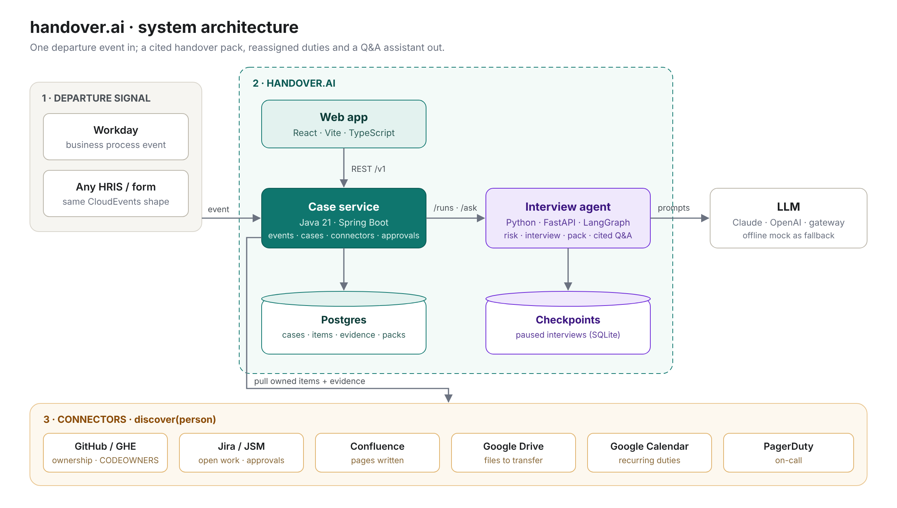

- **Case service** (Java, Spring Boot) is the system of record. It owns cases, items, evidence, answers, packs and approvals, and it is the only thing the UI and HR systems talk to.
- **Interview agent** (Python, LangGraph) is stateless toward the business. It gets items and evidence, keeps its own interview checkpoints, and returns questions, a pack or a cited answer.
- **Connectors** are plugins behind one interface, `discover(person) → items + evidence`. Adding a tool never touches the core.
- **HRIS-agnostic**: Workday is one producer of the `person.departed` CloudEvent; any HR system or a form can send the same shape.

## 2. End-to-end flow

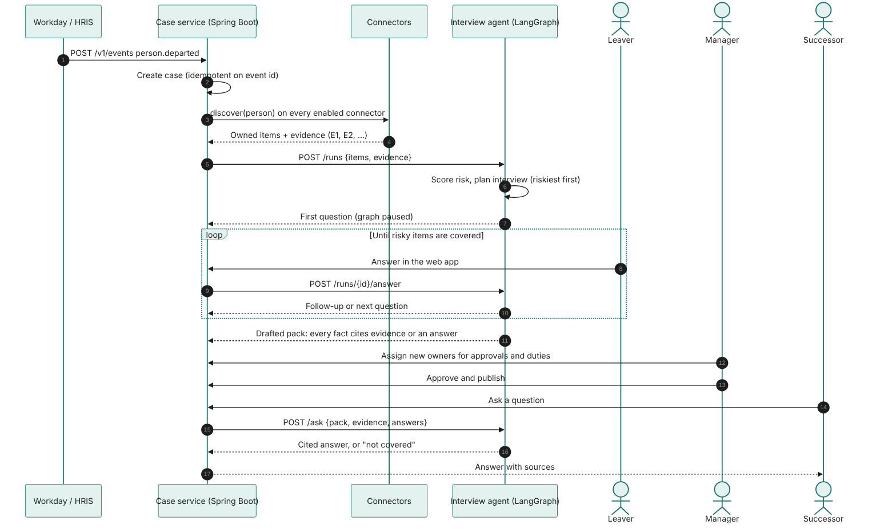

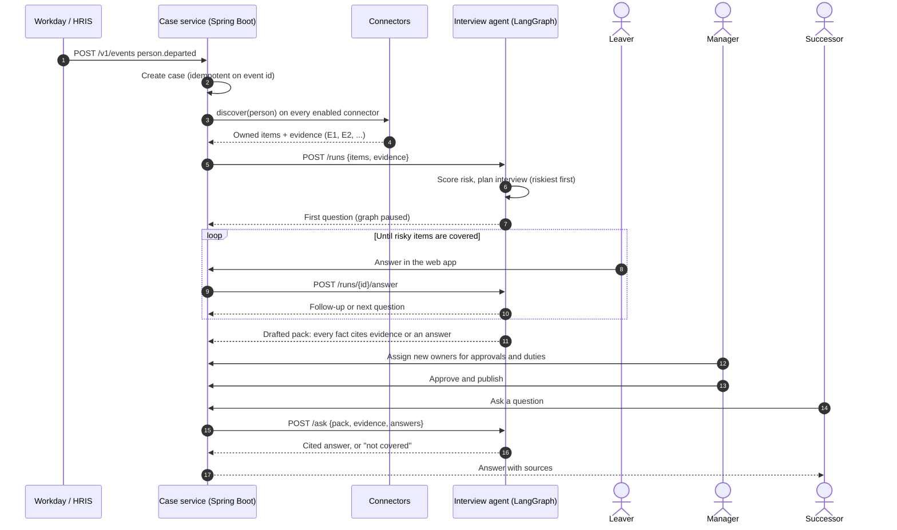

## 3. Agent graph (LangGraph)

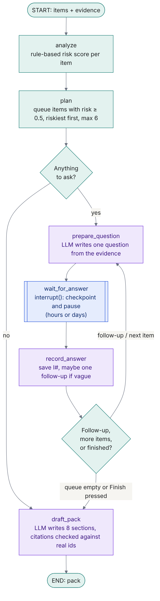

`wait_for_answer` calls `interrupt()`: the graph checkpoints and returns, so an interview can pause for days and resume where it left off. The question is written in its own node, so resuming never re-runs that LLM call. Risk scoring is rule-based, not LLM-based, so every score can be explained in the UI.

| Signal | Effect on risk |
| --- | --- |
| Item kind | recurring duty / approval +0.30, service / customer / on-call +0.25, repo / ticket queue +0.15 |
| No runbook or docs | +0.35 |
| Activity (last 90–180 days) | up to +0.30 |
| Ownership share | up to +0.20 (e.g. owns 61% of commits) |
| Touched in the last 2 weeks | +0.05 |
| Must be reassigned (approver, on-call, meeting owner, file owner) | +0.10 |

Items scoring 0.5 or more are interviewed, riskiest first, with at most 6 topics and one follow-up per topic when an answer is vague.

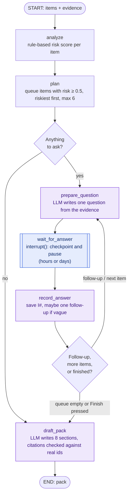

## 4. What each connector finds

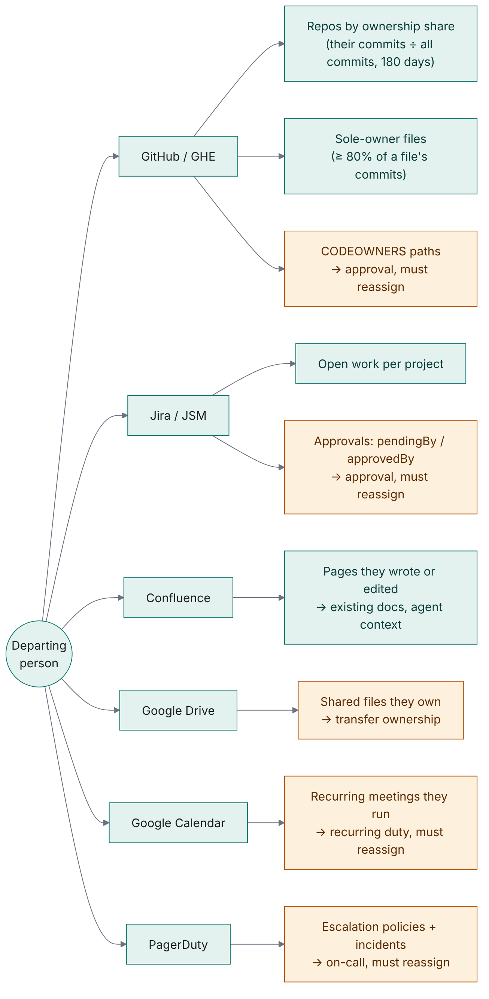

Amber items are **rights or duties that stop working when the account closes**: approvals, required reviewers, on-call slots, meetings they organize, and files they own. They are flagged "must reassign", interviewed for decision criteria, and tracked until each has a new owner.

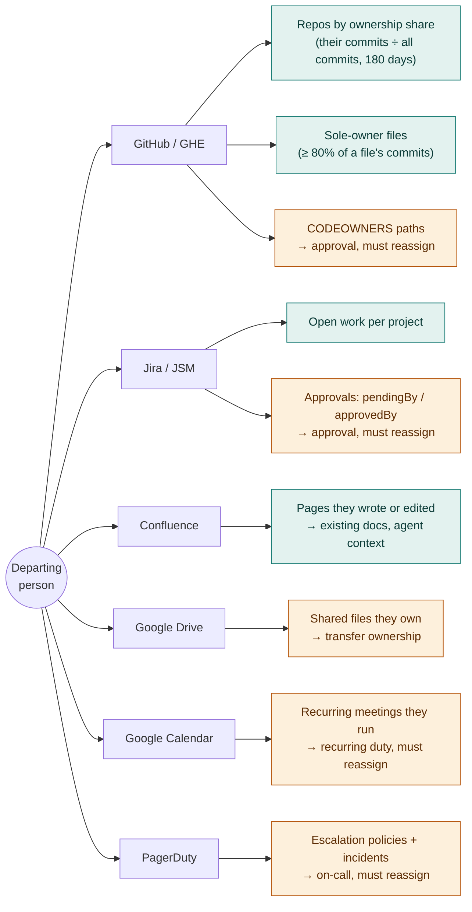

## 5. Case lifecycle

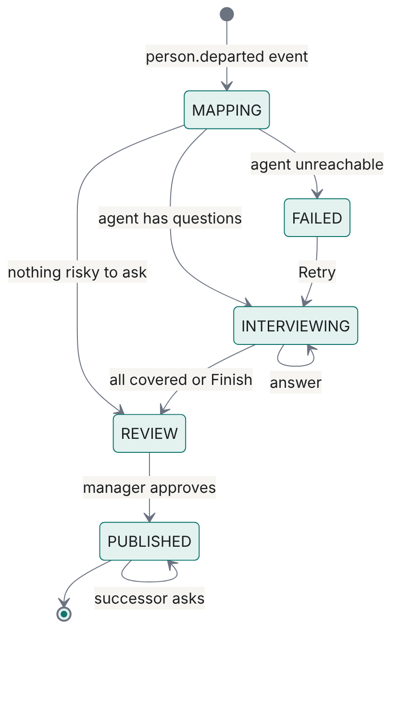

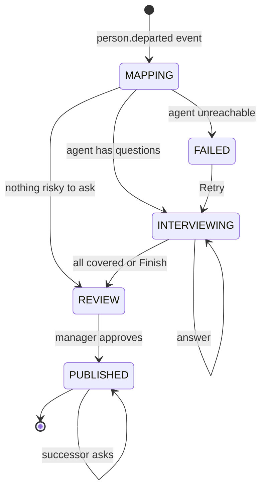

## 6. Data model

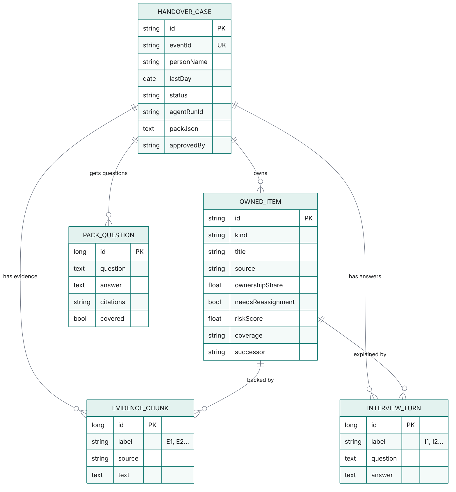

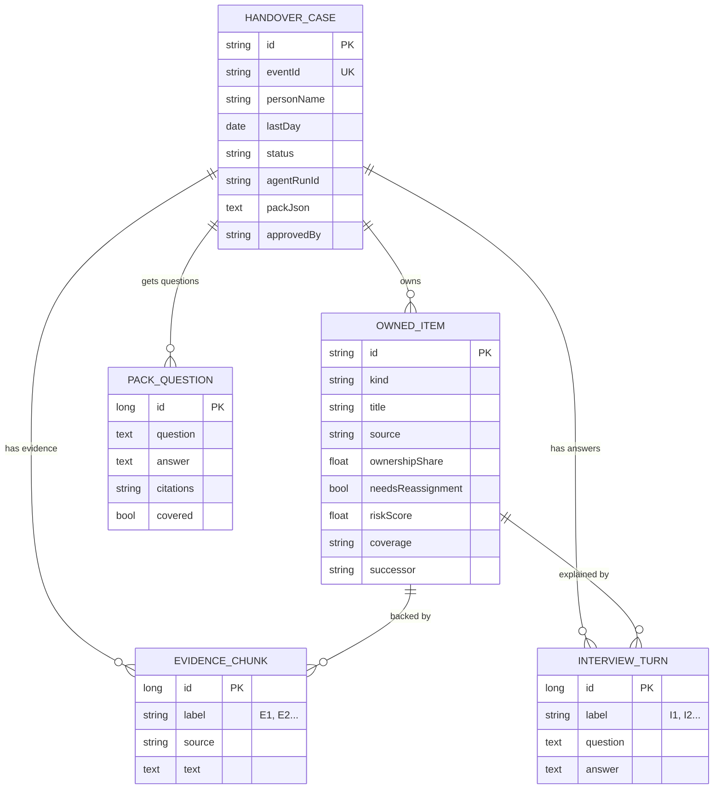
