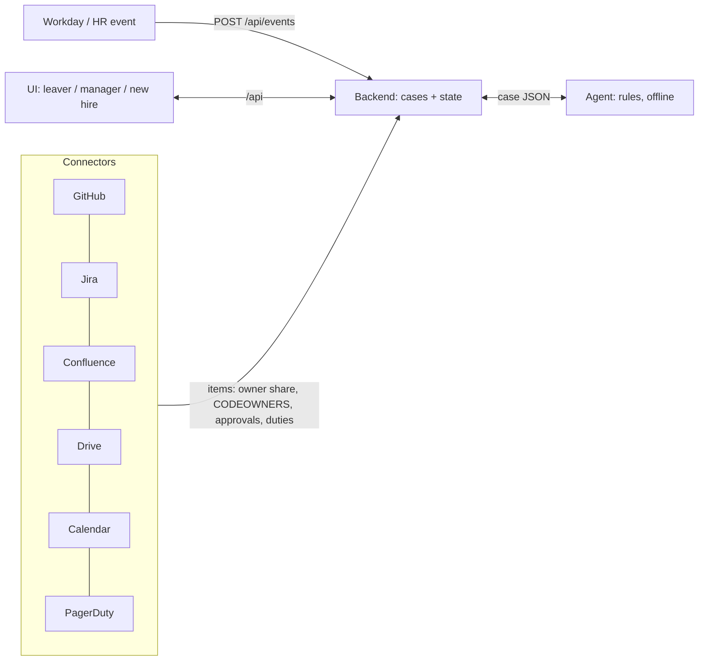

# handover.ai

When someone resigns, handover.ai maps what only they know, interviews them, writes a cited handover pack, works out what the replacement needs, and builds a 90-day onboarding kit for that exact role.

A dependency-free build of handover.ai with the redesigned UI. It lives beside the main
stack (the `agent/`, `backend/` and `ui/` folders at the repo root) and does not replace it.

```
lite/
  agent/     Python (stdlib). Interview, pack, cited Q&A, backfill skills, onboarding kit. Stateless.
  backend/   Node (no dependencies). Cases, connectors (demo data), approvals, media upload. Serves the UI.
  ui/        Plain JavaScript modules + CSS. No build step.
  run.sh     Starts agent (:8000) and backend+UI (:8080)
```

## Run it

Needs Python 3 and Node 18+. Nothing to install.

```bash
cd lite
./run.sh
# open http://localhost:8080
```

Tests: `cd agent && python3 -m unittest` (6 tests).

## Architecture



- The **agent is stateless**: the backend sends the whole case, the agent returns the next question, the pack, an answer, the backfill profile or the kit.
- Every fact in the pack carries a source chip (tool evidence or interview answer). Ask answers quote their source, and say "Not covered" instead of guessing.
- The agent runs on rules, so it needs no API key. Swap `agent/logic.py` functions for LLM calls to get fluent prose; the request and response shapes stay the same.

## Three viewpoints

Every case has a "See it as" switch (also `?as=leaver|manager|newhire` in the URL, so you can open three tabs).

| Who | Can do |
|---|---|
| Leaver | Remove things that aren't theirs, add what no tool sees, answer the interview (type, speak, link, upload or record a video), review the pack |
| Manager | Name new owners (amber until done), watch the interview, publish the pack, see Backfill skills and the onboarding kit |
| New hire | First 90 days, Ask the handover, read the pack (after it is published) |

## 4-minute demo

1. Home: **Priya resigns**. She lands on "What you own": billing-sync (61% of changes), the quarter-end script, CODEOWNERS reviewer role, on-call, a Drive file. Click **Not mine** on one, **Add something** by hand.
2. **Interview**: answer one question with one short sentence to see the follow-up. Add a Drive link. Press **Finish early and write the pack**.
3. Switch to **Suresh (manager)**: type new owners (amber blocks turn green), open **Pack** (hover the source chips), **Approve and publish**, then **Backfill** and **Onboarding kit**.
4. Switch to **Dev (new hire)**: First 90 days, then Ask: "How do I run the quarter-end reconciliation script?" and "What is the office wifi password?" (Not covered).
5. Bonus: **Meera resigns**. Her map is mostly approvals that must be reassigned.

## Notes

- Connectors return demo data (`backend/src/demo.js`). A real connector returns items in the same shape.
- Data is kept in `backend/data.json`; **Reset demo** on the home page clears it.
- Uploaded videos go to `backend/media/` (200MB limit each). Dictation uses the browser's speech recognition (Chrome, Edge, Safari). Screen recording needs a browser permission prompt.
